# Two-edged Sword

A Bible study app for macOS and Windows, for reading Bibles, commentaries, dictionaries and books
beside your own notes. It comes with 60 modules: the KJV and some twenty more Bibles (among them the
Berean Standard Bible, Tyndale, the Geneva, the Douay-Rheims, the Vulgate, the Septuagint and the Peshitta, and Strong's and word-by-word editions), Strong's dictionaries, BDB and Abbott-Smith, the Treasury of Scripture Knowledge, five commentaries (Matthew Henry, JFB, Clarke,
Barnes, Wesley), dictionaries from Easton's to the ISBE, a book of fifteen Bible maps, and four books: the works of Josephus,
Edersheim's Life and Times of Jesus the Messiah, Fox's Book of Martyrs and The Pilgrim's Progress.
It also reads modules in e-Sword X's formats: your own, and on a Mac e-Sword X's library if you have it.
It never changes them: your journal, highlights and plans are kept separately.

See it on the [Two-edged Sword website](https://two-edged-sword.davies.co.za/).

**Contents:** [Download](#download) · [What it does](#what-it-does) · [Quick start](#quick-start) · [Thanks](#thanks) · [Licence](#licence) · [Documentation](#documentation)

## Download

### Mac

For a Mac with Apple silicon (M1 or later) and macOS 13 or later.

1. Download [Two-edged-Sword.dmg](https://github.com/waynetd777/two-edged-sword/releases/latest/download/Two-edged-Sword.dmg) from the [latest release](https://github.com/waynetd777/two-edged-sword/releases/latest).
2. Open it and drag **Two-edged Sword** onto **Applications**.
3. Open Two-edged Sword from Applications. macOS says it can't check the app for malicious software, because it isn't notarised by Apple. Click **Done**.
4. Open System Settings › Privacy & Security, scroll down and click **Open Anyway** beside Two-edged Sword, then **Open Anyway** again and enter your password.

It opens normally after that. The first time you use some features, macOS asks for permission: see [First run](docs/features.md#first-run).

### Windows

For Windows 10 or 11, 64-bit.

1. Download [Two-edged-Sword_x64-setup.exe](https://github.com/waynetd777/two-edged-sword/releases/latest/download/Two-edged-Sword_x64-setup.exe) from the [latest release](https://github.com/waynetd777/two-edged-sword/releases/latest).
2. Run it. It installs for you alone, with no administrator password.
3. If Windows says it protected your PC, click **More info**, then **Run anyway**: the app isn't code-signed.
4. Open Two-edged Sword from the Start menu.

A few things differ on Windows: see [On Windows](docs/features.md#on-windows).

The app checks for updates once a day and offers to install them. **Check for Updates…** checks now: at the foot of Settings, and in the app menu on a Mac or the notification-area menu on Windows.

<a href="docs/images/index.md#the-readme"><picture><source media="(prefers-color-scheme: dark)" srcset="docs/images/read-dark.png">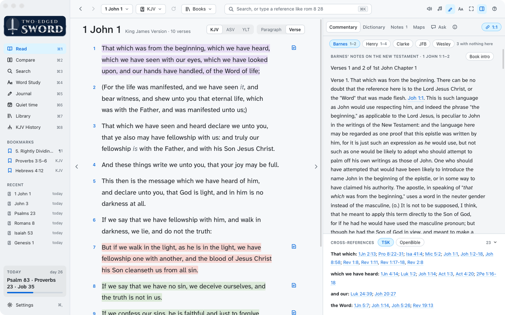</picture></a>

## What it does

- **Read** a chapter beside every commentary on the verse, cross-references, dictionaries and
  your notes. Click any word for its Greek or Hebrew.
- **Highlight** in eight colours, each standing for a theme you name.
- **Books and devotionals** from your library: highlight, bookmark, note, listen to or ask about any paragraph, as you would a verse.
- **Listen** to anything read aloud, each word highlighted as it's spoken.
- **Differences from the KJV**: a mark wherever a translation differs in meaning from the KJV, with the reason.
- **Greek, Hebrew, Latin and Syriac** word by word, each word over its English and Strong's number.
- **Ask** questions about what you're reading, answered from your own library.
- **Compare** translations side by side, **Search** the whole library, and **Word Study** a Greek
  or Hebrew word.
- **Journal** entries linked to their verses, saved as Markdown files, so a notes app that works with Markdown, such as [Brainstead](https://brainstead.davies.co.za/), can open them too.
- **Quiet time** plans, with worship songs chosen for the day and a daily reminder. Songs can be chosen for any chapter too.
- **Build more modules** from free sources, such as the Targums, the Talmud and Beza's Greek New Testament.
- **KJV History**: the manuscripts and editions behind the KJV, and which of them you have.

<table>
  <tr>
    <td align="center"><a href="docs/reading.md#books-and-devotionals"><picture><source media="(prefers-color-scheme: dark)" srcset="docs/images/books-dark.png">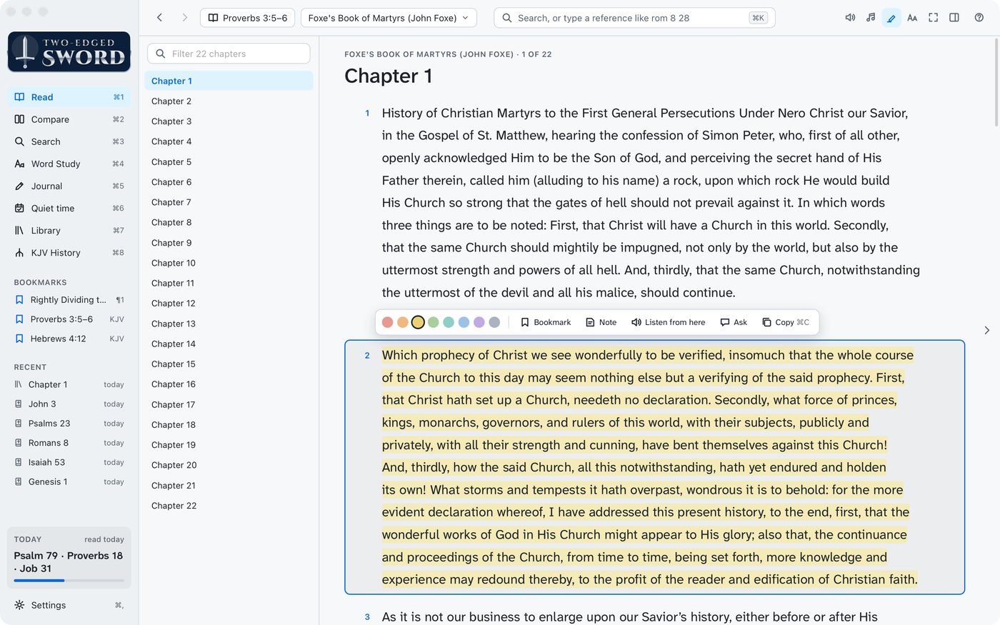</picture></a><br><sub><a href="docs/reading.md#books-and-devotionals">Books and devotionals</a></sub></td>
    <td align="center"><a href="docs/reading.md#listen"><picture><source media="(prefers-color-scheme: dark)" srcset="docs/images/listen-dark.png">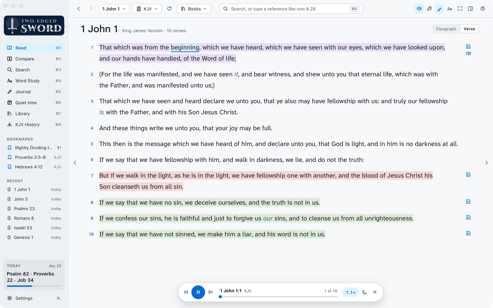</picture></a><br><sub><a href="docs/reading.md#listen">Listen, word by word</a></sub></td>
  </tr>
  <tr>
    <td align="center"><a href="docs/manuscripts.md#differences-from-the-kjv"><picture><source media="(prefers-color-scheme: dark)" srcset="docs/images/differences-dark.png">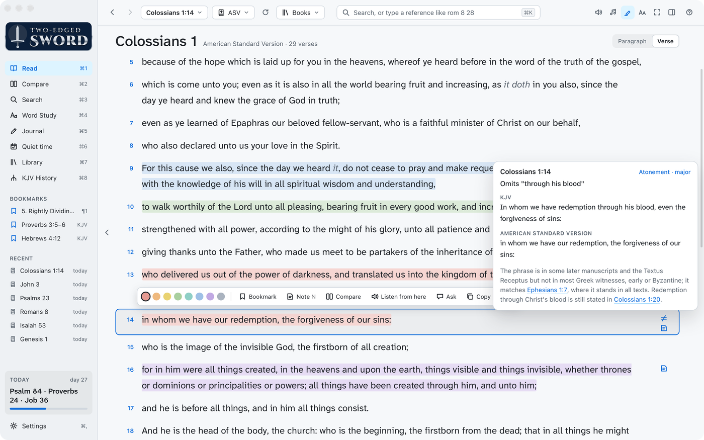</picture></a><br><sub><a href="docs/manuscripts.md#differences-from-the-kjv">Differences from the KJV</a></sub></td>
    <td align="center"><a href="docs/manuscripts.md#greek-and-hebrew"><picture><source media="(prefers-color-scheme: dark)" srcset="docs/images/interlinear-dark.png">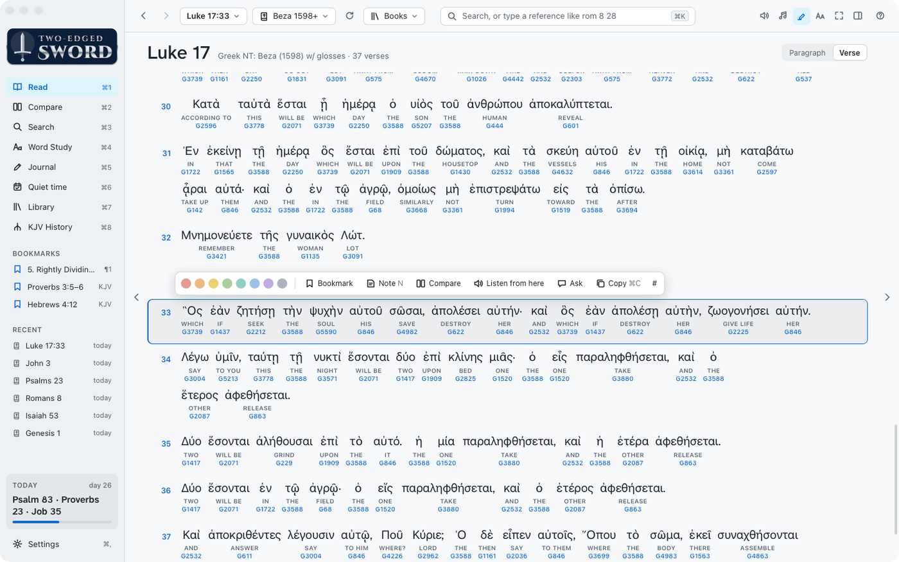</picture></a><br><sub><a href="docs/manuscripts.md#greek-and-hebrew">Greek word by word</a></sub></td>
  </tr>
  <tr>
    <td align="center"><a href="docs/ask.md"><picture><source media="(prefers-color-scheme: dark)" srcset="docs/images/ask-dark.png">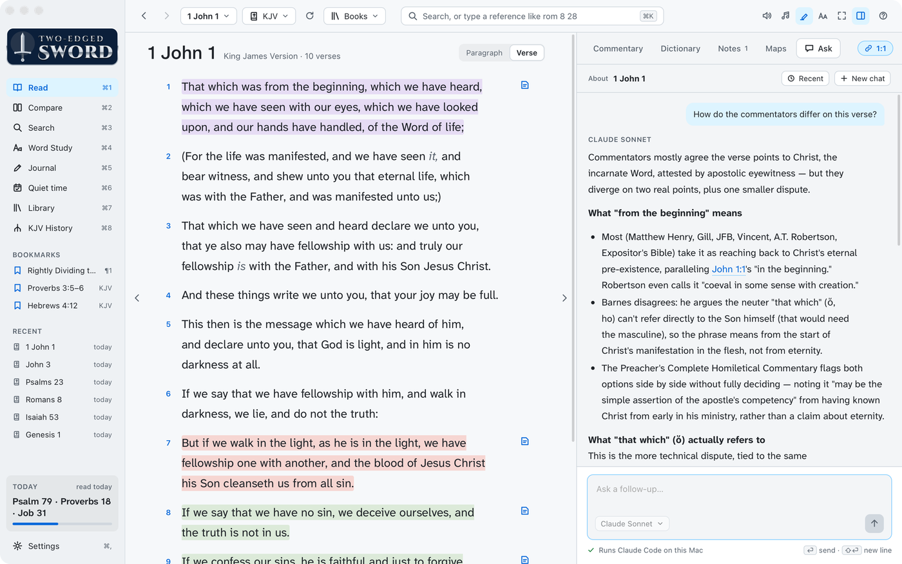</picture></a><br><sub><a href="docs/ask.md">Ask compares the commentators</a></sub></td>
    <td align="center"><a href="docs/study.md#compare"><picture><source media="(prefers-color-scheme: dark)" srcset="docs/images/compare-dark.png">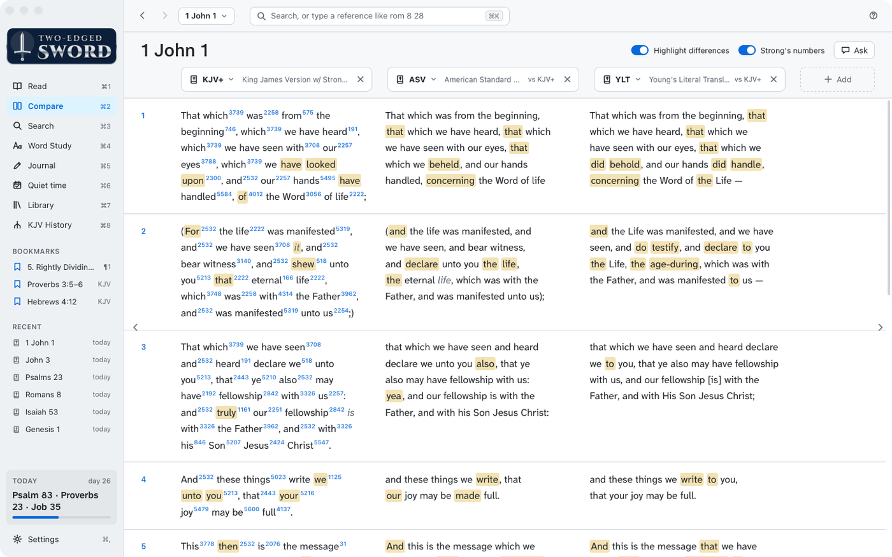</picture></a><br><sub><a href="docs/study.md#compare">Compare translations</a></sub></td>
  </tr>
  <tr>
    <td align="center"><a href="docs/study.md#search"><picture><source media="(prefers-color-scheme: dark)" srcset="docs/images/search-dark.png">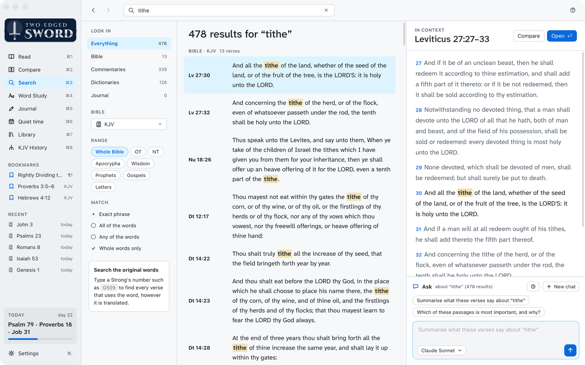</picture></a><br><sub><a href="docs/study.md#search">Search the whole library</a></sub></td>
    <td align="center"><a href="docs/study.md#word-study"><picture><source media="(prefers-color-scheme: dark)" srcset="docs/images/word-study-dark.png">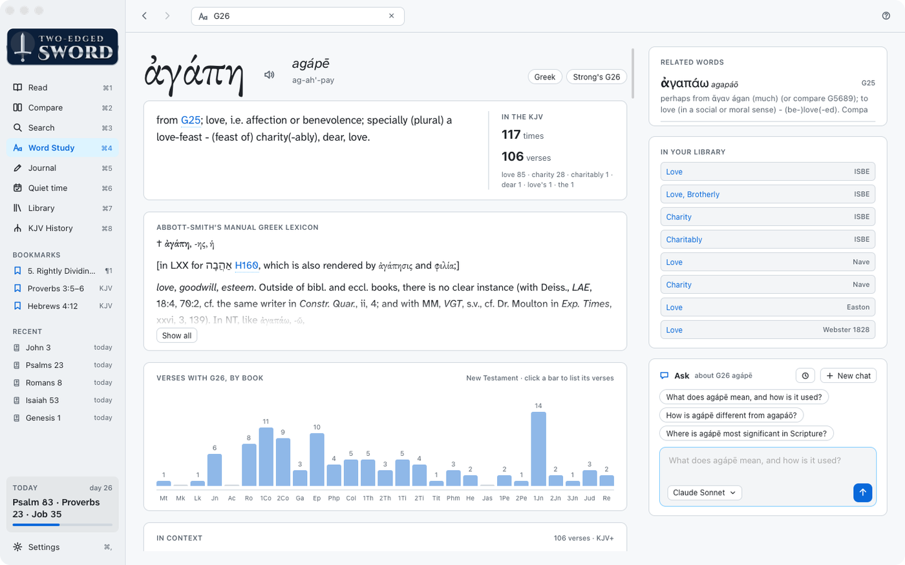</picture></a><br><sub><a href="docs/study.md#word-study">Word Study</a></sub></td>
  </tr>
  <tr>
    <td align="center"><a href="docs/journal.md"><picture><source media="(prefers-color-scheme: dark)" srcset="docs/images/journal-dark.png">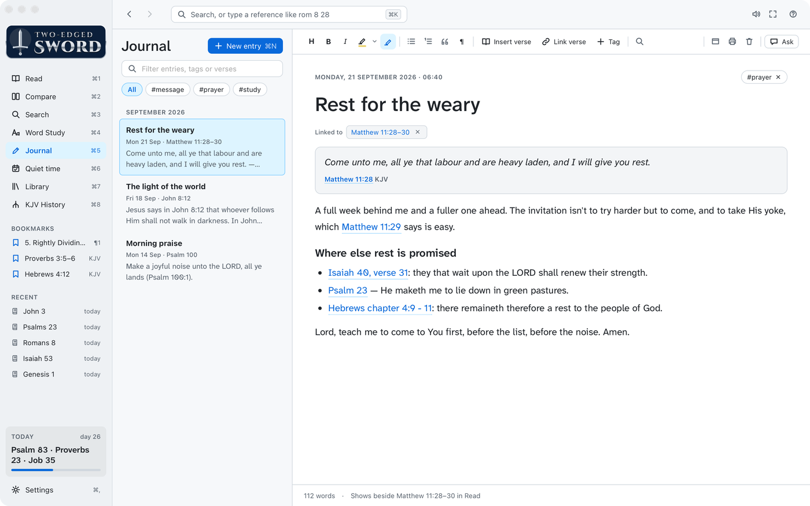</picture></a><br><sub><a href="docs/journal.md">Journal, linked to verses</a></sub></td>
    <td align="center"><a href="docs/quiet-time.md#plans"><picture><source media="(prefers-color-scheme: dark)" srcset="docs/images/quiet-time-dark.png">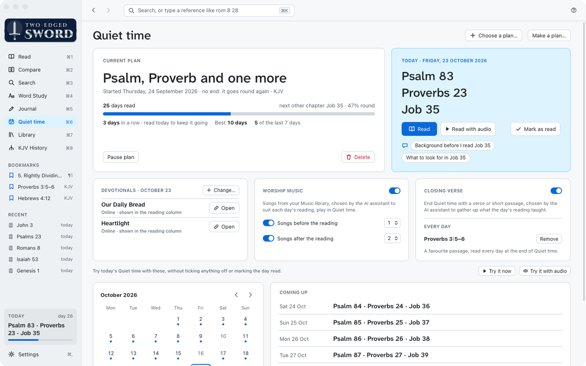</picture></a><br><sub><a href="docs/quiet-time.md#plans">Quiet time plans</a></sub></td>
  </tr>
  <tr>
    <td align="center"><a href="docs/quiet-time.md#worship-music"><picture><source media="(prefers-color-scheme: dark)" srcset="docs/images/worship-dark.png">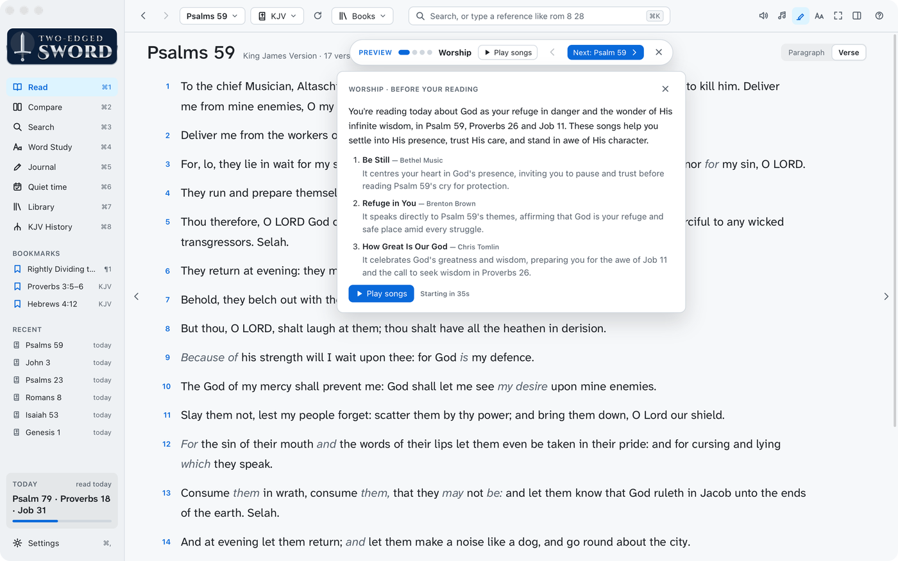</picture></a><br><sub><a href="docs/quiet-time.md#worship-music">Worship songs for the day</a></sub></td>
    <td align="center"><a href="docs/manuscripts.md#kjv-history"><picture><source media="(prefers-color-scheme: dark)" srcset="docs/images/kjv-history-dark.png">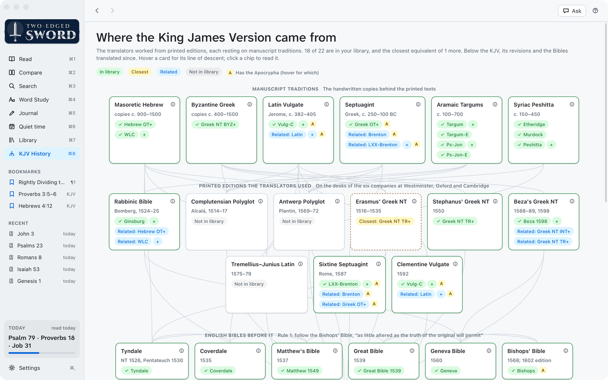</picture></a><br><sub><a href="docs/manuscripts.md#kjv-history">KJV History</a></sub></td>
  </tr>
</table>

## Quick start

Needs macOS 13 or later, the Xcode Command Line Tools, Rust and Node. The built-in modules
are downloaded and built on the first `make dev` or `make app` (`make core`). Ask also needs Claude Code, Codex, Antigravity or GitHub Copilot.

```sh
npm install
make dev                                  # the app with hot reload
cp signing.local.example signing.local    # then name your signing certificate in it
make install-app                          # build it and put it in /Applications
```

On Windows (10 or 11) it needs Rust, Node, Python and Visual Studio Build Tools with the C++
workload: `npx tauri build --debug --no-bundle` builds the app and `npx tauri build` the installer
(see [Development](docs/development.md#commands)).

If you have e-Sword X and no signing certificate, macOS asks again for access to its data after every build
([Signing and Full Disk Access](docs/development.md#signing-and-full-disk-access)).

Licensed Bibles are read where e-Sword keeps them and never copied into this repo.

## Thanks

To Rick Meyers, whose free e-Sword has put God's word into the hands of millions since 2000. This
app reads e-Sword X's formats and library, and owes that to his work
([e-sword.net](https://www.e-sword.net)).

## Licence

Two-edged Sword is free software under the [GNU General Public License](LICENSE), version 3 or
later: you may use, share and change it, and anything you pass on must stay free under the same
licence. The Bible texts and books it reads keep their own terms. The built-in modules are public
domain or openly licensed ([Library](docs/library.md#built-in-modules)); the terms of the rest are in
[Licence and credits](docs/features.md#licence-and-credits).

Three built-in modules are for non-commercial use only. Vulg-C+ (`src-tauri/modules/clementine+.bbli`),
whose word-by-word tagging comes from a model trained on the PROIEL treebank, is shared under
[CC BY-NC-SA 4.0](https://creativecommons.org/licenses/by-nc-sa/4.0/). Targum+ and Ps-Jon+
(`targum_aramaic+.bbli` and `pseudojonathan_aramaic+.bbli`), whose English partly comes from a digitisation of Jastrow's
dictionary, are shared under [CC BY-NC 4.0](https://creativecommons.org/licenses/by-nc/4.0/). If you sell the app or a
build of it, leave those three out (`tools/core/build.py` builds them as `clementine+`, `targum_aramaic+` and
`pseudojonathan_aramaic+`).

## Documentation

The same guides are in the app, under Help (⌘?).

- [Getting started](docs/getting-started.md): step-by-step walk-throughs of everything the app does
- [Features](docs/features.md): getting around and Settings, then [Reading](docs/reading.md),
  [Study](docs/study.md), [Translations and manuscripts](docs/manuscripts.md),
  [Journal](docs/journal.md) and [Quiet time](docs/quiet-time.md)
- [Ask](docs/ask.md): the AI assistant and what it sends
- [Library](docs/library.md): your modules, adding and building more, and free ones worth having
- [Development](docs/development.md): building, signing, where data lives, and the code
