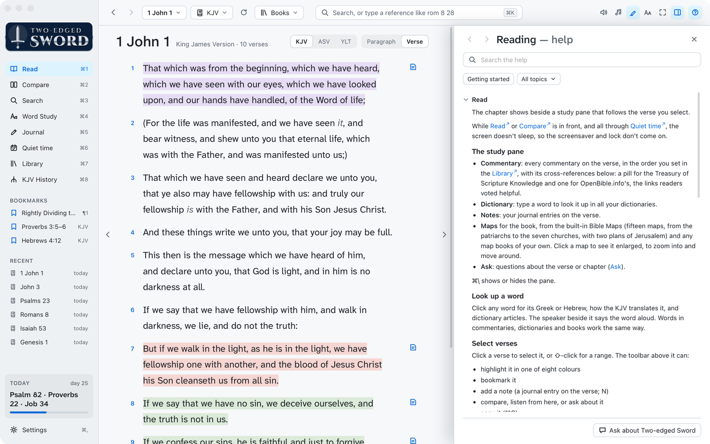

# Features

A Bible study app for macOS and Windows, for reading Bibles, commentaries, dictionaries and books
beside your own notes. It comes with 48 modules: the KJV and some twenty more Bibles (among them the
Berean Standard Bible, Tyndale, the Geneva, the Douay-Rheims, the Vulgate, the Septuagint and the Peshitta, and Strong's and word-by-word editions), Strong's dictionaries, BDB and Abbott-Smith, the Treasury of Scripture Knowledge, five commentaries (Matthew Henry, JFB, Clarke,
Barnes, Wesley), dictionaries from Easton's to the ISBE, and a book of fifteen Bible maps; and it reads more modules in
e-Sword X's formats: your own, and on a Mac e-Sword X's library if you have it.
It only reads them, and keeps your journal, highlights and plans separately.

| Page | What's in it |
|---|---|
| [Getting started](getting-started.md) | Step-by-step walk-throughs of everything the app does |
| [Reading](reading.md) | Read with the study pane, books and devotionals, Listen, songs for the chapter |
| [Study](study.md) | Compare translations, Search, Word Study |
| [Translations and manuscripts](manuscripts.md) | Differences from the KJV, Greek and Hebrew, KJV History, the Targums and Talmud |
| [Journal](journal.md) | Entries linked to verses, kept in step with Obsidian |
| [Quiet time](quiet-time.md) | Reading plans, worship music, the reminder, the menu bar |
| [Ask](ask.md) | The AI assistant and what it sends |
| [Library](library.md) | Your modules, adding and building more |

## First run

<!-- mac -->
The app isn't notarised by Apple, so macOS blocks it the first time it's opened. To open it:

1. Open it once and close the warning.
2. Go to System Settings › Privacy & Security and click **Open Anyway** beside Two-edged Sword.

After that, macOS asks once for each thing the app uses:

| Prompt | When | For |
|---|---|---|
| Access data from other apps | First launch, if e-Sword X is installed | Reading e-Sword X's library |
| Documents folder | First journal save | The journal, in Documents › Two-edged Sword |
| Notifications | Turning on the daily reminder | The [reminder](quiet-time.md#daily-reminder) |
| Control Music | First worship song | [Worship music](quiet-time.md#worship-music) |

Something refused by mistake can be allowed in System Settings › Privacy & Security.
<!-- /mac -->

<!-- windows -->
On Windows, if Windows says it protected your PC when you run the installer, click **More info**,
then **Run anyway**: the app isn't code-signed. It installs for you alone, with no administrator
password, and asks for nothing more.
<!-- /windows -->

## Updates

- The app checks for a new version once a day, and soon after it opens.
- When there is one, it asks the next time its window is in front, with what's new in it:
  **Install and Restart**, **Later** (asked again the next day) or **Skip This Version**. Esc is Later.
- Installing shows the download's progress, saves your work and restarts the app.
- **Check for Updates…** checks now: at the foot of Settings, and in the <!-- mac -->app menu<!-- /mac --><!-- github --> on a Mac or the <!-- /github --><!-- windows -->notification-area menu<!-- /windows --><!-- github --> on Windows<!-- /github -->.<!-- windows --> An update installs with a progress window and reopens the app.<!-- /windows -->
- An update waits while Ask is answering or the search index is being built.

<!-- windows -->
## On Windows

The app works the same on Windows, with these differences:

| | On Windows |
|---|---|
| Shortcuts | Ctrl in place of ⌘, as the menus and the help show them |
| e-Sword | e-Sword for Windows' modules can't be read: their text is encrypted. Modules in e-Sword X's formats work, in your modules folder ([Adding modules](library.md#adding-modules)) |
| Your data | In `%APPDATA%\Two-edged Sword`. Uninstalling with **Delete the application data** ticked removes it; your journal in Documents stays |
| Voices | Windows' own: add more, Hebrew and Greek included, as [Better voices](reading.md#better-voices) says |
| Spelling and grammar | Windows' spell checker, and grammar by Harper, on the PC |
| Worship songs | The music files in your Music folder, played by the app ([Worship music](quiet-time.md#worship-music)) |
| The menu bar icon | In the notification area, by the clock, with Help and Check for Updates… |
| Ask | Each AI tool is installed in your Windows account ([Ask](ask.md#claude-code-codex-antigravity-or-copilot)) |
<!-- /windows -->

## Getting around

| Keys | Does |
|---|---|
| ⌘1 to ⌘8 | Switch screens |
| ⌘K | Go to a reference, word, Strong's number or command |
| ⌘[ and ⌘] | Back and forward, to where you were |
| ⌘, | Settings |
| ⌘+ and ⌘− | Bigger or smaller reading text: the Bible, books, the journal and the Study pane |
| ⌘P | Play or pause reading aloud ([Listen](reading.md#listen)) |
| ? or ⌘? | Help for the screen you're on |

- **Back and forward** (top left) remember screens, passages, words and searches.
- The **sidebar** lists your bookmarks and recent chapters. Hover one for a preview; × removes it.
- Hover any control to see what it does.
- The **Help** menu has this help (⌘?) and **Two-edged Sword Website**. **About Two-edged Sword**, in the
  app menu, shows the version, with the website under it.
- The **?** at the top right opens the help beside the screen, at the part of the guides for that
  screen. Type to search every page; **Getting started** and **All topics**, under the search box,
  open the walk-throughs and the other guides; **Ask about Two-edged Sword** asks the assistant instead.
  Esc closes it.

<a href="images/index.md#features"><picture><source media="(prefers-color-scheme: dark)" srcset="images/help-dark.png"></picture></a>

## Settings

- **[Appearance](app:settings#appearance)**: theme, font and size, words of Jesus in red, verse or paragraph layout.
- **[Bibles](app:settings#bibles)**: the default translation, up to three favourites, and the [Compare](app:compare) columns.
- **[Highlights](app:settings#highlights)**: a name for each of the eight colours, such as a theme.
- **[Listening](app:settings#listening)**: voices, speed, whether to highlight each word and read on, and the pictures
  shown while a song plays, with a verse beneath each and the Bible it's from.
- **[Journal](app:settings#journal)**: its folder, notes beside verses, and grammar checking.
- **[Quiet time](app:settings#quiet-time)**: the daily reminder, and what to do when you fall behind.
- **[AI assistant](app:settings#ai-assistant)**: which tools are installed, the default model, what Ask may read and send, and
  whether it suggests a next question ([Ask](ask.md)).
- At the bottom: the app's version and build number, its licence, and **Website**, which opens
  [two-edged-sword.davies.co.za](https://two-edged-sword.davies.co.za/).

## Licence and credits

Two-edged Sword is free software under the GNU General Public License, version 3 or later.

- You may use it, share it and change it.
- Anything you pass on, changed or not, must stay free under the same licence, with its source.
- It comes with no warranty.
- The licence is in `LICENSE` in the source, and at [gnu.org](https://www.gnu.org/licenses/gpl-3.0.html).

The Bibles and books keep their own terms:

| What | Terms |
|---|---|
| The built-in modules | Public domain, most of them: eBible.org and the CrossWire Bible Society (the KJV, the TSK), eBible.org (the ASV, WEB, YLT, Darby, Webster and Brenton), berean.bible (the BSB), CrossWire (Tyndale, Geneva, Douay-Rheims, the Peshitta), the Clementine Vulgate Project, Open Scriptures (Strong's), CrossWire, the Christian Classics Ethereal Library and Wikisource (the commentaries and dictionaries). Openly licensed: OpenBible.info's places, cross-references and the places on the maps (CC BY), STEPBible's word-by-word English (CC BY), GLAUx's Septuagint word forms in LXX-Brenton+ (CC BY-SA), Ginsburg's Hebrew Bible (Apache 2.0 and GPL 3). Non-commercial only: Vulg-C+, whose tagging comes from a model trained on the PROIEL treebank (CC BY-NC-SA); leave it out of any build that's sold |
| Modules built from the source code's scripts | As each script says: most public domain or CC BY (STEPBible, Open Scriptures), a few for personal study |
| e-Sword X's modules | e-Sword's licence: read where e-Sword keeps them, never copied |

The app is built with Tauri, React and SQLite (MIT, Apache 2.0 and public domain), and its
fonts (Literata, Source Serif 4, EB Garamond, Inter, Atkinson Hyperlegible Next and Cinzel
Decorative) are under the SIL Open Font License.

Thanks to Rick Meyers for e-Sword ([Thanks to e-Sword](library.md#thanks-to-e-sword)).
