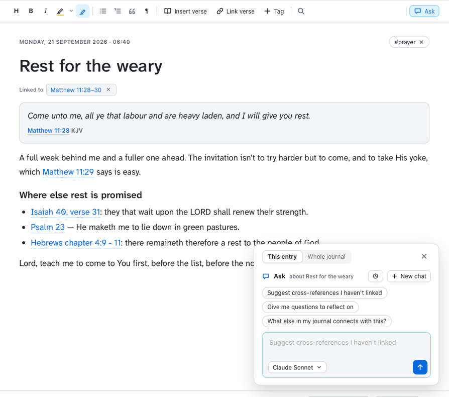

# Journal

[Features](features.md) › Journal

[Write](#write) · [Listen and focus](#listen-and-focus) · [Ask about your journal](#ask-about-your-journal) · [Spelling and grammar](#spelling-and-grammar) · [Where it's kept](#where-its-kept)

## Write

<a href="images/index.md#journal"><picture><source media="(prefers-color-scheme: dark)" srcset="images/journal-dark.png"></picture></a>

⌘N starts a dated entry. Each entry is linked to the verses it's about, and shows beside them in
[Read](app:read).

The toolbar has headings, bold, italic, lists and quotes, and can:

- highlight, in the same eight colours as Read and books
- insert a verse from the Bible, or link one
- add a tag

**Tags.** Type # in an entry to pick a tag from a list: your highlight themes first, then the tags
you use most. Arrow keys and Enter choose one.

**Find entries.** The tags above the list of entries filter it: your most used come first, and
**+ more** shows the rest. The box above them filters by words, tags (with or without #) or verses;
Esc clears it.

**Verse references** you type become links. Hover one to read the verse; click it to open it. Most
ways of writing a reference work, even common misspellings ("Isiah").

⌘F finds in the entry and ⌥⌘F replaces.

## Listen and focus

**Listen** (top right) reads the entry aloud, highlighting each word. Space or ⌘P pauses, and F7
and F9 go to the previous or next entry.

**Focus mode** (⌘.) hides everything but the entry. Esc leaves it.

## Ask about your journal

<a href="images/index.md#journal"><picture><source media="(prefers-color-scheme: dark)" srcset="images/journal-ask-dark.png"></picture></a>

**Ask** (right of the toolbar) has two choices:

- **This entry**: about the entry and its verses. Select some text first to ask about just that,
  for example to explain it or suggest verses. **Insert into entry** adds the answer.
- **Whole journal**: about every entry the list shows, so a tag or filter narrows it. For
  example: "What themes keep coming back?"

An answer from Ask anywhere in the app can be added to the journal in one click.

## Print

**Print** (the printer button in the toolbar) saves entries as a PDF, or as one Markdown file. Choose which:

- **This entry**.
- **On** its verses, or its chapter: every entry written on them.
- **The entries in the list**: a tag or filter narrows it.
- **From** this month, the last 3 months, this year or chosen dates.

Up to 50 entries print at a time.

With 3 or more, the PDF opens with a cover: the dates, how much you wrote, and where in the Bible the entries are. Then:

| Option | What it does |
| --- | --- |
| Order | Oldest or newest first |
| Group | None, by tag (each entry's first tag) or by book (its first verse's) |
| Verse text | Each entry's verses, from the Bible you're reading |
| In your words | The names you use for God, the words and phrases you repeat, when you write and what you highlighted. Worked out from your text; nothing is sent anywhere |
| Overview | With an AI assistant set up: an opening on how the entries relate, and their key themes |
| New page | Each entry on a page of its own |

Every page is numbered, and the PDF opens once it's saved.

## Spelling and grammar

<!-- mac -->macOS checks<!-- /mac --><!-- github --> On a Mac, macOS checks; <!-- /github --><!-- windows -->The app checks<!-- /windows --> spelling (red underline) and grammar (blue underline). Click an underlined word for
suggestions. Words and phrases from the KJV, such as "maketh" and "thou art", aren't marked.

<!-- windows -->
On Windows, spelling is Windows' own spell checker, and grammar is checked by Harper, which runs on the PC: nothing you write is sent anywhere.
<!-- /windows -->

Grammar checking can be turned off in Settings › Journal.

## Where it's kept

Entries are Markdown files, one per month, in `~/Documents/Two-edged Sword/`. To use them in a
notes app that works with Markdown files, such as [Brainstead](https://brainstead.davies.co.za/),
choose one of its folders in Settings › Journal.

Changes made there show in the app within a few seconds.
