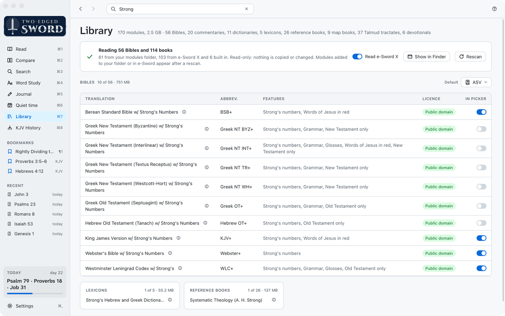

# Library

The app reads Bibles and books from three places, and never changes them:

| Folder | What |
|---|---|
| `~/Library/Application Support/Two-edged Sword/Modules/` | Your modules folder: what you copy in, and modules you build |
| `~/Library/Containers/net.e-sword.e-Sword-X/Data/Library/Application Support/` | e-Sword X's library, if you have e-Sword X |
| Inside the app | The built-in modules (below) |

- Where more than one has a module, the first in this list is used.
- e-Sword X isn't needed. Without it, that folder is skipped.
- To leave e-Sword X's library out, turn off **Read e-Sword X** on the Library screen.

## The Library screen

<a href="images/index.md#library"><picture><source media="(prefers-color-scheme: dark)" srcset="images/library-dark.png"></picture></a>

- Every module, with its size and features. The ⓘ beside one shows its description and which
  folder it came from.
- **In picker** chooses which Bibles appear in the Bible menu.
- Set the default Bible, and the order of [commentaries](app:library#commentaries) and [dictionaries](app:library#dictionaries).
- **Rescan** picks up modules added since the app started.
- **Show in <!-- mac -->Finder<!-- /mac --><!-- github --> (Mac) or <!-- /github --><!-- windows -->File Explorer<!-- /windows --><!-- github --> (Windows)<!-- /github -->** opens your modules folder.
- **Read e-Sword X** turns e-Sword X's library on or off.
- [In e-Sword X too](app:library#copies) lists the modules both the app and e-Sword X have, and which copy each reads. The app's is the default.

## Built-in modules

The app comes with these, so it works with nothing else installed. All are public domain except where the table says otherwise; each module's information has its credits.

| Module | From |
|---|---|
| King James Version (KJV), with the words of Christ in red | eBible.org and CrossWire |
| King James Version with Strong's numbers (KJV+) | eBible.org and CrossWire |
| Strong's Hebrew and Greek Dictionaries | Open Scriptures |
| King James Concordance (KJC) | Counted from the KJV+ |
| Treasury of Scripture Knowledge (TSK), the cross-references | CrossWire |
| Matthew Henry's Commentary on the Whole Bible | CrossWire, from the Christian Classics Ethereal Library |
| Easton's Bible Dictionary | CrossWire, from the Christian Classics Ethereal Library |
| American Standard Version (ASV, 1901) | eBible.org |
| World English Bible (WEB), with the words of Christ in red | eBible.org |
| Young's Literal Translation (YLT) | eBible.org |
| Darby Translation (1890) | eBible.org |
| Webster's Bible (1833) | eBible.org |
| Revised Version (RV, 1885) | eBible.org |
| Weymouth New Testament (1912) | CrossWire |
| Brenton's English Septuagint (1844), with the Apocrypha | eBible.org |
| Greek NT: Byzantine Majority Text (Byz, 2018) | Robinson and Pierpont |
| Byz+: the Byzantine Greek NT word by word | Robinson and Pierpont; English from STEPBible (CC BY) |
| WLC+: the Hebrew Old Testament word by word | Open Scriptures and STEPBible (CC BY) |
| Webster's Bible with Strong's numbers (Webster+) | eBible.org; the numbers carried over from the KJV+ |
| Berean Standard Bible (BSB), with the words of Christ in red | berean.bible |
| Berean Standard Bible with Strong's numbers (BSB+) | berean.bible, from its translation tables |
| Jamieson, Fausset & Brown Commentary (JFB) | CrossWire, from the Christian Classics Ethereal Library |
| Adam Clarke's Commentary on the Bible | CrossWire, from Wikisource |
| Barnes' Notes on the New Testament | CrossWire |
| Wesley's Explanatory Notes | CrossWire |
| OpenBible.info Cross-References, the links readers voted helpful | OpenBible.info (CC BY) |
| Smith's Bible Dictionary | CrossWire |
| Nave's Topical Bible | CrossWire, from the Christian Classics Ethereal Library |
| International Standard Bible Encyclopedia (ISBE) | CrossWire |
| Torrey's Topical Textbook | CrossWire |
| Hitchcock's Bible Names | CrossWire, from the Christian Classics Ethereal Library |
| Bible Places: where each place is, and the verses that name it | OpenBible.info (CC BY) |
| Webster's Dictionary (1828) | CrossWire, Akai Tsurugi's edition (CC BY-SA) |
| Brown-Driver-Briggs Hebrew Lexicon (BDB), unabridged | Eliran Wong's edition |
| Abbott-Smith's Manual Greek Lexicon | CrossWire |
| Spurgeon's Morning and Evening | CrossWire, from the Christian Classics Ethereal Library |
| Daily Light on the Daily Path | CrossWire |
| Bible Maps: the land in Jesus' day, Paul's journeys, the Exodus, the tribes | Drawn for the app, from OpenBible.info (CC BY), NASA and USGS terrain and Natural Earth |

Where e-Sword X has a module the app also has, the app's copy is read. To read e-Sword's instead, choose **e-Sword X** beside it under [In e-Sword X too](app:library#copies) on the Library screen. That list shows while **Read e-Sword X** is on.

## Formats

The app reads e-Sword X's Mac formats:

| Extension | What |
|---|---|
| `.bbli` | Bibles |
| `.cmti` | Commentaries |
| `.dcti` | Dictionaries |
| `.lexi` | Lexicons |
| `.refi` | Reference books, and maps and timelines |
| `.devi` | Devotionals |

The Library lists maps and timelines on a card of their own: e-Sword's picture books (starred there) and books titled Maps or Atlas. The Talmud's tractates have their own card too.

It doesn't read the Windows formats (`.bblx`, `.cmtx` and so on), EPUB or SWORD modules. Where a
module comes in both, take the Mac one. That holds on Windows too: e-Sword for Windows encrypts its
modules' text.

## Adding modules

- **From e-Sword**: e-Sword X's Download window installs them in its library.
- **From elsewhere**: copy the file into your modules folder (not a subfolder). **Show in <!-- mac -->Finder<!-- /mac --><!-- github --> (Mac) or <!-- /github --><!-- windows -->File Explorer<!-- /windows --><!-- github --> (Windows)<!-- /github -->**
  on the Library screen opens it.

Then press **Rescan**.

## Building modules

Some texts aren't e-Sword downloads. They are built from free sources by scripts that come with
the app's source code, not with the app itself. Once built, they go in your modules folder and
show after **Rescan**. They're numbered like the KJV, so they compare beside it.

| Text | From |
|---|---|
| Syriac Peshitta NT, Murdock, Etheridge, Tyndale, Geneva 1599, Douay-Rheims | CrossWire |
| Targum, Targum Pseudo-Jonathan, the Babylonian Talmud | Sefaria |
| Clementine Vulgate (1592) | Clementine Vulgate Project |
| Ginsburg's Hebrew Bible (1894), and Ginsburg+ word by word | Ginsburg Hebrew Bible project |
| Beza's Greek New Testament (1598), and Beza 1598+ word by word | textus-receptus.com, STEPBible |
| Brenton's Greek Septuagint with the Apocrypha, and LXX-Brenton+ word by word | eBible.org, STEPBible |
| Latin+ and Vulg-C+, word by word | Stanza, Whitaker's WORDS |
| Targum+ and Ps-Jon+, word by word | Sefaria, Jastrow |
| Peshitta+, word by word | ETCBC, SEDRA |
| The Rheims New Testament (1582) | Bible Support |

All are public domain or openly licensed, except some Sefaria translations, SEDRA's glosses and
Jastrow, which are for non-commercial use. That's fine for personal study.

## Free modules worth having

These are public domain. Those marked e-Sword come from e-Sword X's Download window; the rest are
on [Bible Support](https://www.biblesupport.com) (free sign-in).

**Bibles**

- Greek NT INT+ (e-Sword): the best single tool for the Greek behind the KJV and modern versions.
- Greek NT TR+ and WH+ (e-Sword): two more Greek texts with Strong's numbers and grammar.
- Greek OT+ and Hebrew OT+ (e-Sword): the Old Testament in Greek and Hebrew, with Strong's
  numbers.

**Commentaries**

- Keil & Delitzsch on the Old Testament, and Spurgeon's Treasury of David on the Psalms
  (e-Sword).
- Vincent's Word Studies (e-Sword): Greek word studies. Robertson's Word Pictures (e-Sword) is like it, but not all public domain: its last two volumes are in copyright in the US until 2028 and 2029.
- The Cambridge Bible, Bullinger's Companion Bible and MacLaren's Expositions (e-Sword); Lange and
  Meyer (Bible Support).

**Books and devotionals**

- Edersheim's Life and Times of Jesus the Messiah, the Ante-Nicene Fathers, Calvin's Institutes
  and Schaff's History of the Christian Church (e-Sword).
- Spurgeon's Faith's Checkbook and his sermons (Bible Support).

Avoid copyrighted modules shared without the publisher's permission. Books that exist only as
EPUB or text need converting to a `.refi` first.

## Thanks to e-Sword

Rick Meyers has given e-Sword away free since 2000, and it has put God's word, with a lifetime of
commentaries, dictionaries and lexicons, into the hands of millions. This app reads e-Sword X's
formats and, if you have it, its library. We owe that to his work. Thank you, Rick.

- e-Sword is free, but it isn't ours to share. Its licence doesn't allow its modules to be passed
  on, so the app never copies them, and nothing from e-Sword is built into it.
- To support his work, see [e-sword.net](https://www.e-sword.net/support.html).
