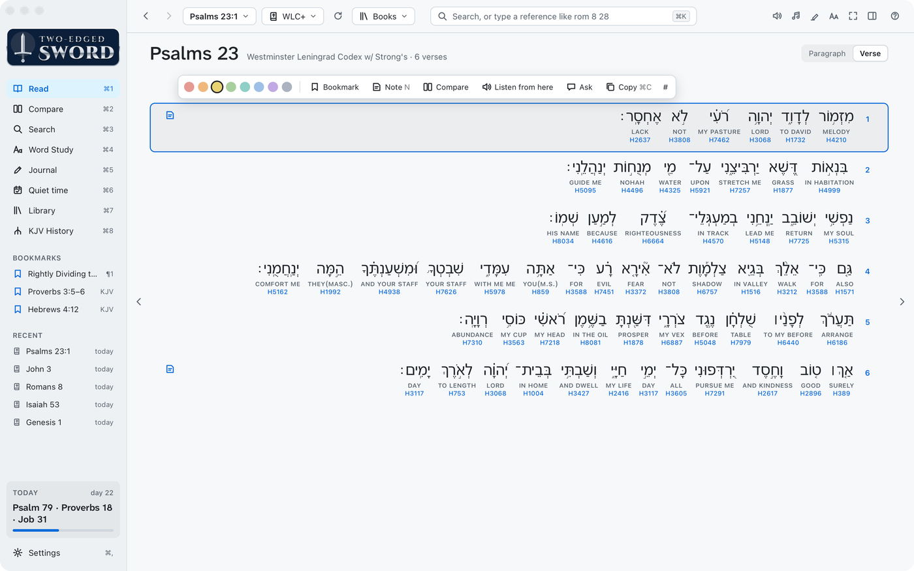
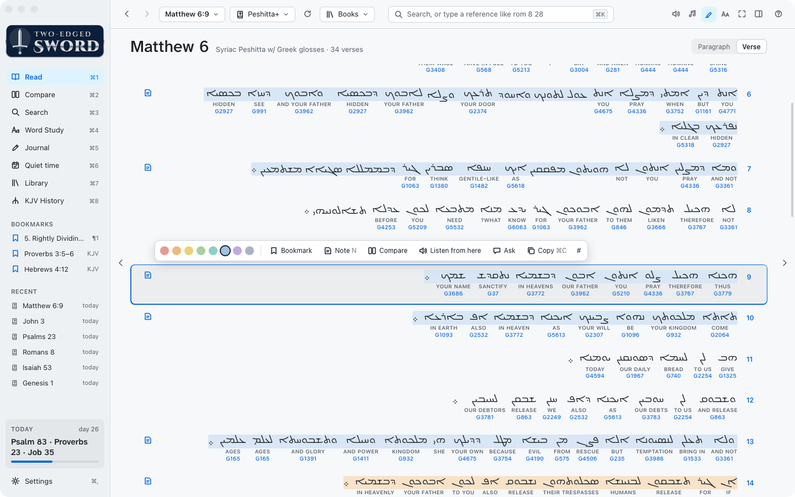

# Translations and manuscripts

[Features](features.md) › Translations and manuscripts

<!-- github -->
**Contents:** [Differences from the KJV](#differences-from-the-kjv) · [Greek and Hebrew](#greek-and-hebrew) · [KJV History](#kjv-history) · [Targums and Talmud](#targums-and-talmud)
<!-- /github -->

## Differences from the KJV

<a href="images/index.md#translations-and-manuscripts"><picture><source media="(prefers-color-scheme: dark)" srcset="images/differences-dark.png"></picture></a>

With verses one per line (**Verse**, beside **Paragraph** in the reader), a **≠** beside a verse marks
where the translation differs in meaning from the KJV, such as an omitted phrase or a changed name of God. A faint ≠ marks a minor difference.

Click it to see both readings, what changed, and why (usually which manuscripts each follows).

Ask uses the same list, so you can ask "how does this chapter differ from the KJV?".

The app comes with lists for the NIV, ESV, ESV+, ASV, CEV, GNB, MKJV and ISV, and for the built-in
BSB, RV, Darby, Weymouth, Douay-Rheims, Brenton's Septuagint, Murdock and Etheridge, each checked across the whole Bible (or the whole New
Testament). A list is used only when you have that translation.

## Greek and Hebrew

<a href="images/index.md#translations-and-manuscripts"><picture><source media="(prefers-color-scheme: dark)" srcset="images/interlinear-dark.png"></picture></a>

Word-by-word Bibles show each original word over its English and its Strong's number.

- Hover a word for its grammar, or a number for its dictionary entry. Click a word to look it up.
- Greek and Hebrew Bibles without English of their own get the KJV's commonest rendering of each
  word. Turn this off in Settings › Appearance.
- Hebrew and Syriac read right to left.
- Built in: Byz+ (Greek New Testament), WLC+ and Ginsburg+ (Hebrew), LXX-Brenton+ (the Septuagint, with the
  Apocrypha), Vulg-C+ (the Latin Vulgate) and Peshitta+ (the Syriac New Testament).
- In Vulg-C+ and Peshitta+ a word's Strong's number is the Hebrew or Greek word it translates, so it opens
  that word's entry. Peshitta+'s English is the Greek's, or Murdock's and Etheridge's where the Greek
  doesn't match; hover a word to see which.

<table>
  <tr>
    <td align="center"><a href="images/index.md#translations-and-manuscripts"><picture><source media="(prefers-color-scheme: dark)" srcset="images/interlinear-hebrew-dark.png"></picture></a> Hebrew (WLC+), Psalm 23</td>
    <td align="center"><a href="images/index.md#translations-and-manuscripts"><picture><source media="(prefers-color-scheme: dark)" srcset="images/interlinear-syriac-dark.png"></picture></a> Syriac (Peshitta+), the Lord's Prayer</td>
  </tr>
</table>

### Other editions' readings

- **Greek NT TR+ and WH+** show another edition's reading in ⟨ ⟩. Hover it to see which edition.
- **Greek NT INT+** marks in red the words that not every edition has, with a letter for each
  edition: τ Stephanus, σ Scrivener, β Byzantine, α Alexandrian, ν NA28.

## KJV History

<a href="images/index.md#translations-and-manuscripts"><picture><source media="(prefers-color-scheme: dark)" srcset="images/kjv-history-dark.png"></picture></a>

**KJV History** (⌘8) is the KJV's family tree: the manuscripts, the printed editions the
translators used, and the English Bibles before it. Below the KJV come its revisions, from
Webster's and the Revised Version to the ESV, and the Bibles translated afresh since.

- The coloured labels on each card show what you have: green is the text itself, amber the closest
  stand-in, blue a related module. Click one to read it. A **+** beside a label opens the edition
  with Strong's numbers, glosses or notes.
- A yellow **A** means that Bible has the Apocrypha.
- Hover a card to light up what it came from and what came from it.
- The **ⓘ** on a card explains what it is and how it bears on the KJV.
- **Ask** opens a panel for questions about the history.

## Targums and Talmud

Once you've built them from Sefaria ([Building modules](library.md#building-modules)):

- The **Targums** read and compare beside the KJV, verse for verse.
- The **Talmud** is a book per tractate, a chapter per page (daf), in English with the Aramaic.
- Ask finds the Talmud passages that cite the verses you're asking about.
