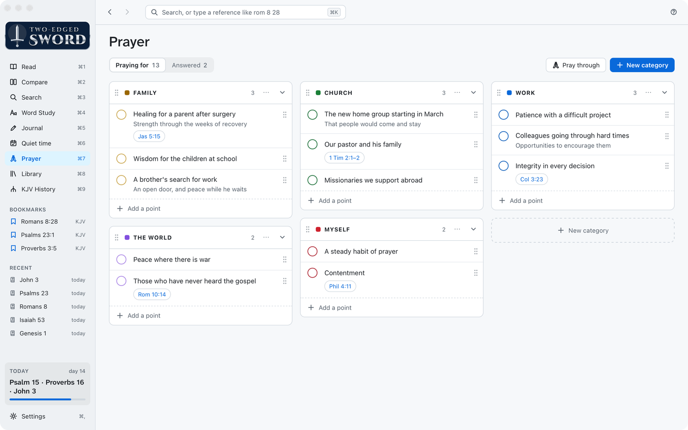
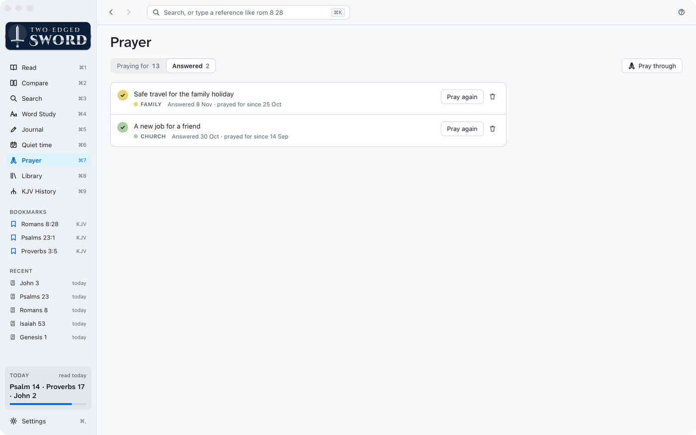
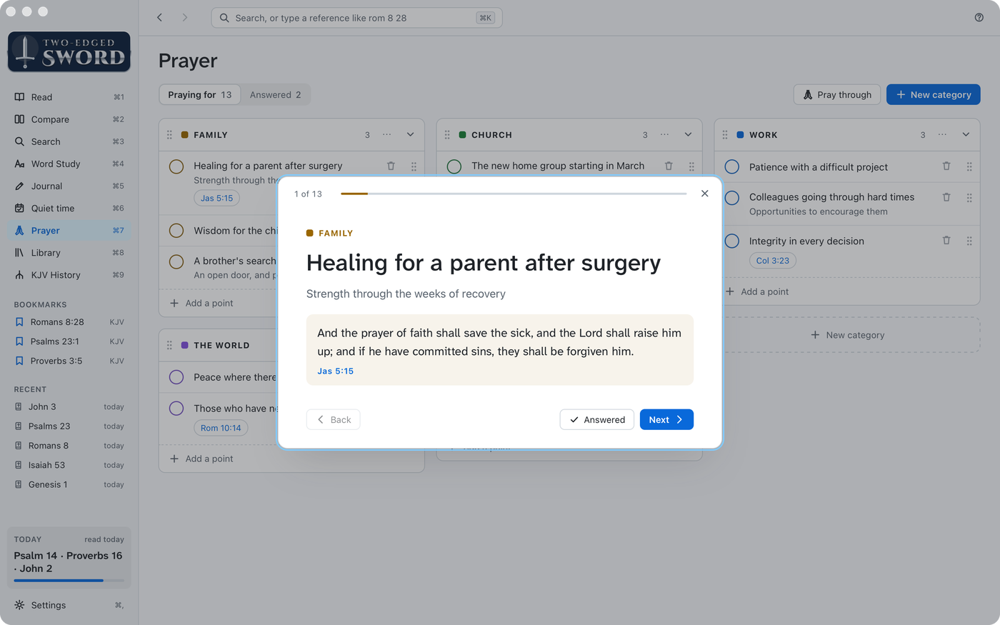

# Prayer

[Features](features.md) › Prayer

<!-- github -->
**Contents:** [Your prayer list](#your-prayer-list) · [Move things](#move-things) · [Answered](#answered) · [Pray through](#pray-through)
<!-- /github -->

## Your prayer list

<a href="images/index.md#prayer"><picture><source media="(prefers-color-scheme: dark)" srcset="images/prayer-dark.png"></picture></a>

Prayer (⌘7) keeps the people and things you pray for, in categories of your own: Family, Work, Church, or anything else.

- **New category** adds one. Type its name and press Return; it's then ready for its first point.
- **Add a point** at the foot of a category adds a prayer point. Return adds it and leaves the box open for the next.
- Click a point to change it. A point can have a short note under it and verses to pray over: type one such as `Phil 4:6` in **Add a verse**. Return adds it; **Done** saves the point with it. Esc leaves the point as it was.
- Click a verse on a point to read it.
- A category's **⋯** renames it, changes its colour, or deletes it with its points.
- Click a category's name, or its arrow, to fold it away. Folding is kept on each device.
- The bin beside a point deletes it, once you've said **Delete** to the question in its place.
- After a category is deleted, or a point ticked answered, **Undo** takes it back for a few seconds.

The list is kept in step with the phone app when they're paired.

## Move things

Drag a point to move it up or down, or into another category, even a folded one. Drag a category by its header to change the order: the cards fold to their names while you do.

| How | Does |
|---|---|
| Drag with the mouse | Moves a point, or a category by its header |
| Touch and hold, then drag | The same on a phone or tablet; the grip ⠿ drags at once |
| ↑ and ↓ on a point's grip | Moves it up or down, and on into the next category |
| ← and → on a point's grip | Moves it to the category before or after |
| Arrow keys on a category's grip | Moves the category |
| Esc while dragging | Puts it back |

## Answered

<a href="images/index.md#prayer"><picture><source media="(prefers-color-scheme: dark)" srcset="images/prayer-answered-dark.png"></picture></a>

Tick the circle beside a point when it's answered. It moves to **Answered** with the day, under the tab at the top. There you can look back on what God has done, **Pray again** to put a point back in its category, or delete it.

## Pray through

<a href="images/index.md#prayer"><picture><source media="(prefers-color-scheme: dark)" srcset="images/prayer-through-dark.png"></picture></a>

**Pray through** shows the points one at a time, category by category, so you can pray for each in turn. A point's verses are shown in full, in the Bible you're reading; click a reference to read it in context.

- **Next** and **Back**, → and ←, or a swipe left or right on a phone or tablet, step through them. Esc closes.
- **Answered** marks the point answered and goes on.

To pray through your list in Quiet time, add a **Prayer** step to a plan's [steps](quiet-time.md#steps), wherever you want it in Quiet time.
