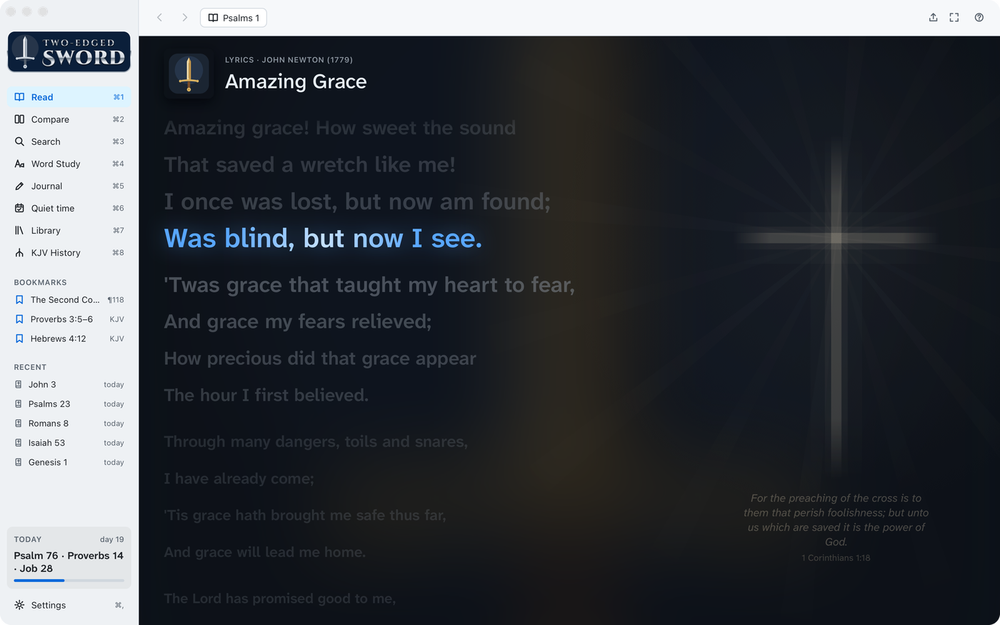
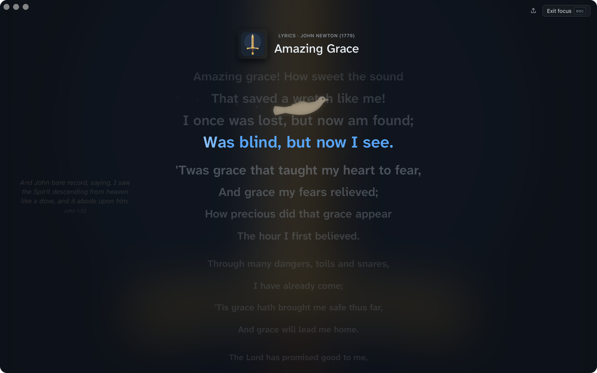
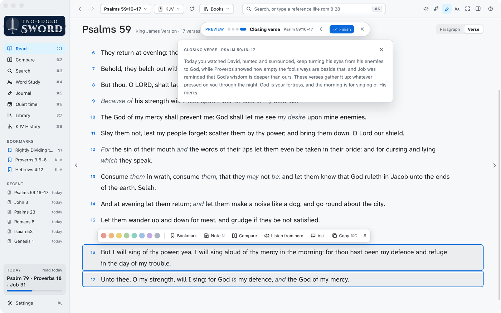
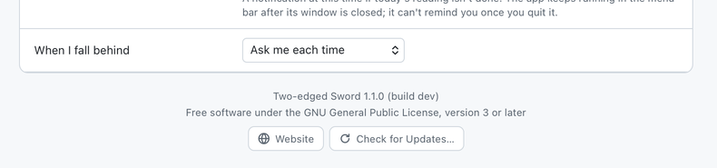
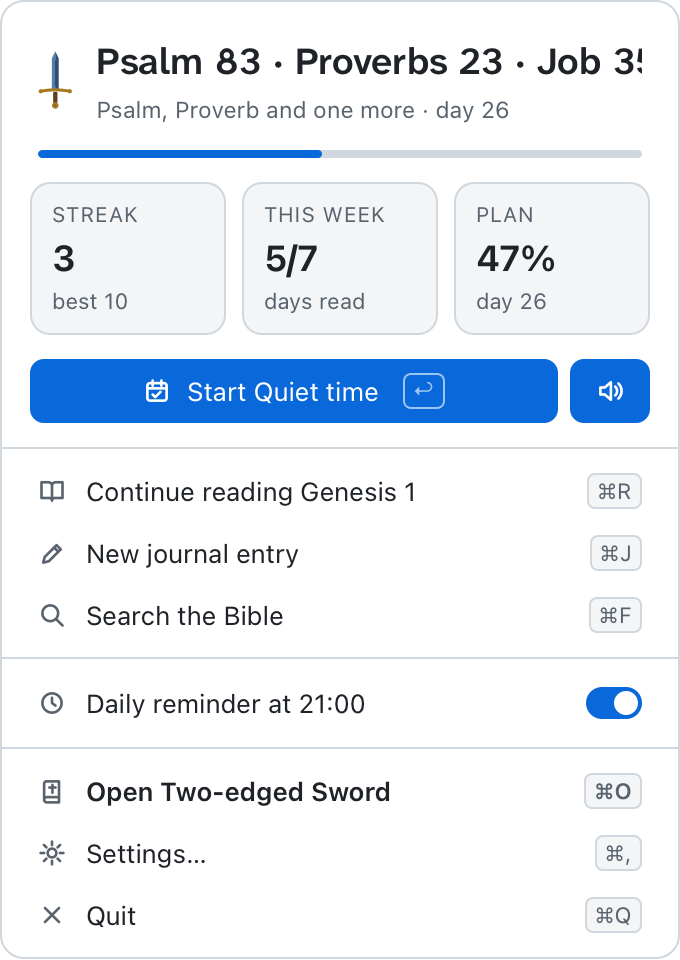

# Quiet time

[Features](features.md) › Quiet time

<!-- github -->
**Contents:** [Plans](#plans) · [Worship music](#worship-music) · [Closing verse](#closing-verse) · [Favourite passage](#favourite-passage) · [Daily reminder](#daily-reminder) · [Menu bar](#menu-bar)
<!-- /github -->

## Plans

<a href="images/index.md#quiet-time"><picture><source media="(prefers-color-scheme: dark)" srcset="images/quiet-time-dark.png"></picture></a>

Choose a reading plan: the Bible in a year, the New Testament in 90 days, the Gospels, F. B.
Meyer's daily readings, a Psalm and a Proverb a day, or your own. You can add devotionals from
your library, or Our Daily Bread and Heartlight online.

- **Read** opens each of the day's readings in turn.
- **Read with audio** reads them aloud, one after another.
- Click a reading on the day's card to open just that one.
- **Mark as unread** undoes today's mark.
- **Pause plan** takes a plan out of today's reading. A paused plan shows **Paused** at the top
  of its card, with **Resume plan** beside it.
- If you delete your current plan and have others, the app asks which one to carry on with.
- **Add a website…**, under Online in the devotionals list, adds a devotional site of your own:
  a name and its address. For a page whose address changes each day, put `{yyyy}`, `{mm}` and
  `{dd}` where the date goes. Your sites can be chosen for any plan; × removes one.
- An online devotional shows in the reading column, under the Quiet time bar. A site that won't
  show inside the app opens in its own window instead; **Open in window** does that for any site.
  In the dark theme the page's colours are inverted to make it dark, but its pictures keep their
  true colours.
- Our Daily Bread opens at today's devotion, found from the site's list of devotions. When read
  aloud, its page stays still during the opening verse, then scrolls with the reading.
- With audio, Our Daily Bread and Heartlight are read aloud by themselves once their page has
  loaded, from the top of the day's reading. Other online devotionals wait for you to click
  **Listen**.
- In the dark theme, each online devotional has a moon button, in the devotionals list and over its
  page, that turns the darkening on or off. Turn it off for a site that's dark already.
- To hear an online devotional, click **Listen** over its page, then click where reading should
  start: the pointer is a hand until you do. Esc cancels. The word being read is highlighted as in
  the Bible reader.
- ⌘+ and ⌘− make an online devotional's page bigger or smaller. Each site keeps its own size.

Each part of the day is ticked off as you finish it. Under the progress bar are your streak, your
best run, and how many of the last seven days you read.

In the calendar, a dot marks a day you read. Hover over a day to see its readings; click it to
open the first.

| Keys | Does |
|---|---|
| F7 and F9 | Previous or next part: what is being read stops at once |
| F8 or ⌘P | Pause and resume reading aloud |

## Worship music

<a href="images/index.md#quiet-time"><picture><source media="(prefers-color-scheme: dark)" srcset="images/worship-dark.png"></picture></a>

Turn it on with the **Worship music** card on a plan's page in Plans. The AI assistant picks songs
from your Music library to suit the day's readings, and a card explains each choice. **Play songs**
plays them in Music. Otherwise they start by themselves after a countdown, which leaves time to
read the card.

- **Songs before the reading** and **Songs after the reading** turn on separately, and each has
  its own number of songs.
- With both on, different songs play after the reading.
- A song Quiet time has played isn't chosen again for 14 days.
<!-- mac -->
- Songs Music can't play aren't chosen: ones Apple Music no longer has, and ones unticked in Music.
<!-- /mac -->
<!-- windows -->
- On Windows the songs are the music files in your Music folder (MP3, M4A, FLAC and others), and
  the app plays them itself. Only songs whose genre is Christian, Gospel or Worship are chosen:
  set it in a file's Properties › Details if it isn't.
<!-- /windows -->

While the songs play, their words show in the reading column, and the Quiet time bar moves up
into the top bar. The song's name, cover and why it was chosen stay at the top while the words
scroll:

<a href="images/index.md#quiet-time"><picture><source media="(prefers-color-scheme: dark)" srcset="images/lyrics-dark.png"></picture></a>

- When the lyrics are timed, the line being sung is lit in blue, with a light sweeping across it,
  and kept in view. It is larger than the rest; the lines before and after it are smaller and
  fainter the further off they are. Dots show where nothing is sung.
- Why each song was chosen shows under its name.
- Songs chosen for a chapter play the same way: see [Songs for the chapter](reading.md#songs-for-the-chapter).
- A song with no lyrics found gets softly burning flames instead, swelling to the song's tempo
  (Music's BPM for it, or a slow tempo if it has none). The app can't hear the music itself.
- Faint pictures come and go behind the words, with lyrics or without, in the colours of the
  song's artwork: a cross, a dove passing over, tongues of fire, hands raised, the throne, chains
  breaking, a river and over a hundred more, one or two at a time. Some are old photographs,
  engravings and paintings: the lion of Judah, Dürer's praying hands, the ark of the covenant,
  the Creation of Adam. Pictures of what the song sings about come more often (a song about
  fire gets fire), and none comes twice in a song. The larger ones stay beside the words, in
  focus mode too. If there's no room for one, it waits or shows smaller.
  Settings › Listening › **While a song plays** turns them off.
- Each picture has a verse beneath it, faint, in the Bible chosen in Settings › Listening ›
  **Verses from** (the default translation until you choose one). A verse stays beside the
  words, clear of any other picture and above the flames. A picture whose verse isn't in that
  Bible comes without one. **Show a verse beneath each picture**, in the same place, turns the
  verses off.
- The Quiet time bar shows how far through the song Music is, with the time gone and the time left.
- The Lyrics page is always dark below its top bar, in the light theme too. In focus mode the
  top bar is dark as well.
- The pointer hides when the mouse is still for a few seconds, and comes back when it moves.
- ⌘. is focus mode: the song across the whole window, the pictures beside it. Esc leaves it.

- **Lyrics** on the bar brings the words back if you've gone elsewhere.
- **Open Music** (top right) switches to Music.

Lyrics come from LRCLIB (lrclib.net), a free public lyrics database. The app sends it the song's
name, artist, album and length. If LRCLIB has no lyrics, any you've saved with the song in Music
are shown, without timing. If LRCLIB is busy, the app tries for a few seconds, then says so: open
the song's Lyrics again later.

**Try it now**, under the Closing verse card on a plan's page, runs today's Quiet time with its
songs and closing verse, without marking anything read. **Try it with audio** does the same, read aloud.

<!-- mac -->
The first time, macOS asks whether the app may control Music.
<!-- /mac -->

## Closing verse

<a href="images/index.md#quiet-time"><picture><source media="(prefers-color-scheme: dark)" srcset="images/closing-dark.png"></picture></a>

Turn it on with the Closing verse card on a plan's page in Plans. Quiet time then ends with a verse
or short passage, chosen by the AI assistant to sum up what the day's reading taught.

- The passage opens in the Bible reader, highlighted, with a card that says in a few sentences
  how it sums up the day.
- With audio, it is read aloud after a countdown that leaves time to read the card. **Read now**
  skips the wait.
- It stays open when it's done. **Finish** ends Quiet time; if you've set a favourite passage, that is read next instead.
- It is chosen while you read, so it's usually ready by the end. The worship songs are chosen to suit it as well as the readings.
- Without an AI assistant, the blessing of Numbers 6:24–26 closes instead.

## Favourite passage

A passage of your own, such as Proverbs 3:5–6, read every day at the very end of Quiet time, after the closing verse. Set it in the Closing verse card, on a plan's page in Plans.

- Type the passage and click **Add**.
- **Remove** stops it.
- It stays open when it's done. **Finish** ends Quiet time.
- It's the same every day, so it plays no part in choosing the day's songs; the closing verse is never the same passage.

## Daily reminder

<a href="images/index.md#quiet-time"><picture><source media="(prefers-color-scheme: dark)" srcset="images/reminder-dark.png"></picture></a>

Turn it on in Settings › Quiet time. At the time you choose, if you haven't read yet, it sends a
notification with the day's readings.

<!-- mac -->
Turning it on sends one notification straight away, so that macOS asks you to allow them. If none
arrive, allow Two-edged Sword in System Settings › Notifications.
<!-- /mac -->

The reminder comes while the app runs, including in the <!-- mac -->menu bar<!-- /mac --><!-- github --> (Mac) or <!-- /github --><!-- windows -->notification area<!-- /windows --><!-- github --> (Windows)<!-- /github --> with its window closed. Turn on
**Open at login** in the menu-bar window (below) so it's always running.

## Menu bar

Closing the window leaves the app in the <!-- mac -->menu bar<!-- /mac --><!-- github --> (Mac) or <!-- /github --><!-- windows -->notification area, by the clock<!-- /windows --><!-- github --> (Windows)<!-- /github -->. Click its icon for a small window; click elsewhere or press Esc to close it.

<a href="images/index.md#quiet-time"><picture><source media="(prefers-color-scheme: dark)" srcset="images/tray-dark.png"></picture></a>

- Today's reading, the plan and how far through it you are. It says when today is done.
- **Streak**, **This week** and **Plan**: days read in a row, days read of the last seven, and the plan's progress. Click any of them to open Plans.
- **Start Quiet time** (↩), or **Choose a plan** without one. The speaker button beside it (⌥↩) starts it read with audio.
- **Continue reading** where you left off (⌘R), **New journal entry** (⌘J) and **Search the Bible** (⌘F).
- **Daily reminder**, to turn it on or off.
- **Open at login**, to start the app in the menu bar when you log in.
- **Open Two-edged Sword** (⌘O), **Settings…** (⌘,) and **Quit** (⌘Q).
<!-- windows -->
- On Windows, where the icon is in the notification area, also **Help** (⌘?) and **Check for Updates…**.
<!-- /windows -->
