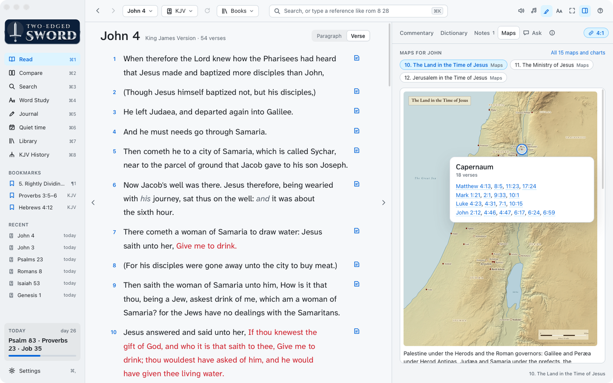
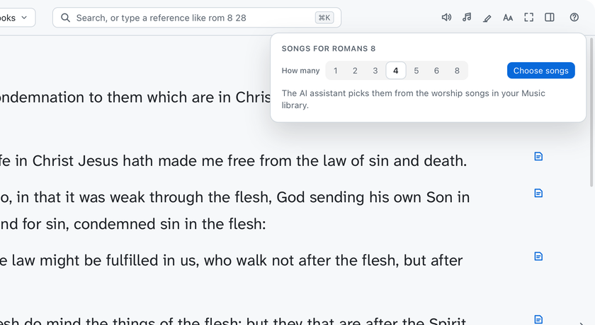

# Reading

[Features](features.md) › Reading

<!-- github -->
**Contents:** [Read](#read) · [Books and devotionals](#books-and-devotionals) · [Listen](#listen) · [Songs for the chapter](#songs-for-the-chapter)
<!-- /github -->

## Read

<a href="images/index.md#reading"><picture><source media="(prefers-color-scheme: dark)" srcset="images/read-dark.png"></picture></a>

Read shows the chapter beside a study pane, which follows the verse you select.

The screensaver and lock don't come on while the app's window is in front showing [Read](app:read) or
[Compare](app:compare), at any time during Quiet time, or while anything is being read aloud.

### The study pane

- **Commentary**: a button for each commentary on the verse, in the order you set in the [Library](app:library#commentaries);
  click one to read it. Below are cross-references, with a button each for the Treasury of Scripture Knowledge and
  OpenBible.info (links that readers voted helpful).
- **Dictionary**: type a word to look it up in all your dictionaries.
- **Notes**: your journal entries on the verse.
- **Maps** for the book: the built-in Bible Maps (fifteen, from the patriarchs to the seven churches, with two plans of
  Jerusalem) and any map books of your own. Click a map to enlarge, zoom and move it.
  On Bible Maps, click a place's dot or name to list its verses. Hover a verse to read it; click it to open it.
- **Ask**: questions about the verse or chapter ([Ask](ask.md)).

<a href="images/index.md#reading"><picture><source media="(prefers-color-scheme: dark)" srcset="images/maps-place-dark.png"></picture></a>

⌘\ shows or hides the pane.

### Look up a word

Click any word for its Greek or Hebrew, how the KJV translates it, and dictionary articles. The
speaker button beside the word says it aloud. This works in commentaries, dictionaries and books too.

### Select verses

Click a verse to select it, or ⇧-click for a range. The toolbar above it can:

- highlight it in one of eight colours
- bookmark it
- add a note: a journal entry on the verse (N)
- compare, listen from here, or ask about it
- copy it (⌘C)

The highlighter button in the top bar hides and shows all highlights.

### Move around

- ← and → turn the page. The passage picker asks for the book, then the chapter, then the verse.
- Hover a reference or Strong's number for a preview.
- ⌘. turns on focus mode: the text fills most of the window, justified. The pointer hides when you stop moving it. Esc leaves it.
- With Settings › Appearance › Show verses as **Paragraphs**, the chapter is justified outside focus mode too.
- ⌘+ and ⌘− make the text bigger or smaller, as the **Aa** slider does, in focus mode too.

### Choose a translation

The Bible you pick lasts until you close the window; then your default (Settings › Bibles) comes
back. Up to three favourite translations (Settings › Bibles) get one-click buttons in the top bar.

A ≠ beside a verse marks where the translation differs from the KJV
([Translations and manuscripts](manuscripts.md)).

### A Bible's own notes

Some Bibles carry their own notes (the ESV+ does). Small marks in the text show where:

- Letters (a, b, …) are cross-references. Click one for the list; each reference opens the verse.
- Numbers are footnotes: other readings, the original wording, manuscript differences.

The marks are hidden in focus mode.

### The Apocrypha

Bibles that have them (the Douay-Rheims, the Vulgates, the Bishops' Bible and the Septuagints) show
an Apocrypha section in the passage picker, between the Testaments. Apocrypha chapters are marked
in yellow wherever they appear.

## Books and devotionals

<a href="images/index.md#reading"><picture><source media="(prefers-color-scheme: dark)" srcset="images/books-dark.png"></picture></a>

The **Books** menu, beside the Bible picker, opens a reference book or devotional. Chapters are
down the side; a devotional opens on today's reading. The app comes with four books: the works of
Josephus, Edersheim's Life and Times of Jesus the Messiah, Fox's Book of Martyrs and The Pilgrim's
Progress. Click a Bible reference in them to open it.

Paragraphs work like verses: click one to highlight it, bookmark it, add a note, listen from there, ask about it or copy it.
The study pane has your notes on the chapter, the dictionaries and Ask.

In the dark theme, a drawing with no background of its own is shown on a light card so its ink stays visible.

Click a picture or chart to see it enlarged. There:

- Scroll, or use two fingers on a trackpad, to zoom in and out.
- Drag to move it around.
- Double-click to fit it again; ← → go to the chapter's other pictures; Esc closes.

## Listen

<a href="images/index.md#reading"><picture><source media="(prefers-color-scheme: dark)" srcset="images/listen-dark.png"></picture></a>

**Listen** (Space or ⌘P) reads the chapter aloud, highlighting each word, and carries on into the next chapter. The verse being read stays a third of the way down the page. The player sets the speed (0.5× to
2×) and a sleep timer.

| Keys | Does |
|---|---|
| Space or ⌘P | Play and pause |
| F7 and F9 | Previous or next chapter |
| Esc | Close the player |

The keyboard's media keys and headphone buttons work too.

### Better voices

<!-- mac -->
On a Mac the app uses the voices installed on it. The **Premium** ones sound far more natural:

1. Open System Settings › Accessibility › Spoken Content › System voice › Manage Voices.
2. Under English, download a voice marked (Premium), such as Zoe or Ava (US), or Jamie (UK).
3. Choose it in the player's voice menu or in Settings › Listening.

Hebrew, Greek and Latin Bibles are read in a Hebrew, Greek or Italian voice. Better ones download
the same way.
<!-- /mac -->

<!-- windows -->
On Windows the app uses Windows' voices. To add more, including Hebrew, Greek and Italian ones:

1. Open Windows Settings › Time & language › Speech, and click **Add voices**.
2. Add the voices you want:

   | Language | Voices |
   |---|---|
   | Hebrew | Asaf |
   | Greek | Stefanos |
   | Italian (for Latin Bibles) | Elsa, Cosimo |
   | English | others, such as Hazel or George (UK) |

3. Restart the app, then choose them in Settings › Listening.

Windows' "natural" voices are only for Narrator, so the app can't use them.
<!-- /windows -->

The speaker beside a Hebrew or Greek word uses the voice chosen for that language in Settings › Listening.

## Songs for the chapter

<a href="images/index.md#reading"><picture><source media="(prefers-color-scheme: dark)" srcset="images/chapter-songs-dark.png"></picture></a>

The ♫ button in the top bar has the AI assistant choose worship songs from your Music library to
suit the chapter you're reading, in the Bible or in a book or devotional.

1. Click ♫ and choose how many songs.
2. Click **Choose songs**. A card says what the chapter is about and why each song suits it.
3. Click **Play songs** to play them in Music. Their words show in the reading column, as in
   [Worship music](quiet-time.md#worship-music), with Pause and Next song in the top bar. Reading
   aloud stops and its player closes.

- **Choose again** picks different songs.
- Quiet time leaves out songs it played in the last 14 days. Songs played from here don't count
  towards that.
- Without an assistant set up, songs are picked at random.
<!-- windows -->
- On Windows the songs come from your Music folder: see [Worship music](quiet-time.md#worship-music).
<!-- /windows -->
